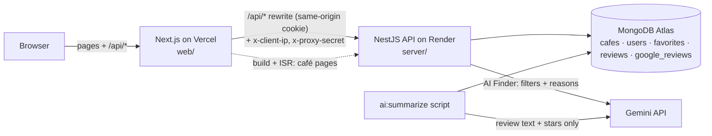

## problem
# Why This Project?

Most existing café discovery platforms focus on location and ratings.

BrewMap AI focuses on **taste**.

Instead of helping users find the nearest café,

we help them find **the right café**.

Finding a good café is surprisingly difficult.

Current platforms such as Google Maps provide thousands of reviews and high ratings, but they rarely answer questions like:

- Which café serves the best latte?

- Which café specializes in pour-over coffee?

- Which matcha café is worth visiting?

- Which café is quiet enough to work from?

- Which café has parking?

- Which café serves chocolate-forward coffee instead of fruity coffee?

Users often spend 20–30 minutes reading reviews before deciding where to go.

Most review platforms also categorize cafés by location rather than by coffee experience.

As a result, people frequently visit cafés that don't match their preferences.


## how to solve


BrewMap AI helps users discover cafés through taste-first recommendations.

Instead of asking:

> "Where should I go?"

We ask:

> "What kind of coffee are you looking for today?"

The AI analyzes user preferences and recommends cafés based on:

- Coffee style

- Flavor profile

- Brewing method

- Atmosphere

- Budget

- Distance

- Community reviews

---

# Target Users

- Coffee lovers

- Specialty coffee beginners

- Tourists

- Digital nomads

- Remote workers

- Matcha lovers

- Café hoppers


## descibe about project idea


BrewMap AI is an AI-powered coffee discovery platform designed to help people find cafés based on their personal taste—not just ratings.

Instead of scrolling through hundreds of Google Maps reviews or generic ranking websites, users can describe what they are looking for in natural language, and AI recommends the most suitable cafés.

The project combines interactive maps, AI recommendations, coffee knowledge, and community-driven reviews into a single experience.


# Core Features

## 🗺 Interactive Coffee Map

Display cafés on an interactive map.

Each café marker includes:

- Photos

- Rating

- Coffee specialties

- Opening hours

- Quick description

- Directions

---

## ☕ Coffee Categories

Browse cafés by category.

Examples:

- Latte

- Flat White

- Espresso

- Pour Over

- Cold Brew

- Matcha Latte

- Ceremonial Matcha

- Dessert Café

- Roastery

- Pet Friendly

---

## 🏆 Top Lists

Curated rankings such as:

- Top 10 Latte

- Top 10 Pour Over

- Top 10 Matcha

- Top Hidden Cafés

- Top Coffee Roasters

- Best Cafés for Working

- Best Scenic Cafés

---

## 🤖 AI Coffee Finder

Users simply describe what they want.

Example:

> I want a quiet café near Nimman with creamy latte, parking, and good Wi-Fi.

The AI recommends cafés and explains why each one matches.

---

## 🔍 Smart Search

Search by:

- Coffee type

- Flavor notes

- Brewing method

- Atmosphere

- Budget

- District

- Distance

---

## ❤️ Favorites

Users can bookmark cafés for future visits.

---

## 📝 AI Review Summary

Instead of reading 2,000 reviews, AI summarizes them.

Example:

Pros

- Excellent dirty coffee

- Friendly staff

- Quiet atmosphere

Cons

- Limited parking

- Long waiting time on weekends

---

## 📷 Café Details

Each café page includes:

- Gallery

- Coffee menu

- Matcha menu

- Signature drinks

- Flavor profile

- Recommended drinks

- Facilities

- Business hours

- Location

- Reviews

---

## 🎯 Personalized Recommendations

The system learns user preferences over time.

Example:

The user usually likes:

- Chocolate notes

- Low acidity

- Milk coffee

- Quiet cafés

Future recommendations become increasingly personalized.

---
# Business Model

## Sponsored Listings

Cafés can pay to promote their business within search results.

---


## Café Subscription

Business dashboard including:

- Analytics

- Customer insights

- AI-generated review summaries

- Marketing tools

---

## Affiliate

Recommend coffee beans, brewing equipment, and accessories.

---

## Events

Promote coffee festivals, workshops, and cupping events.

# Why This Project?

Most existing café discovery platforms focus on location and ratings.

BrewMap AI focuses on **taste**.

Instead of helping users find the nearest café,

we help them find **the right café**.

---

# Vision

Become the smartest AI-powered coffee discovery platform for specialty coffee lovers.

Start with **Chiang Mai**.

Expand to cities across Thailand.

Eventually become the "Spotify for Coffee"—where every recommendation is personalized to each user's taste.
---

# Run locally

The repo has two apps: `web/` (Next.js) and `server/` (NestJS API on MongoDB Atlas).

```bash
# 1. install root + both apps
npm install
npm run install:all

# 2. env files
cp server/.env.example server/.env   # fill in MONGODB_URI
cp web/.env.example web/.env.local   # API_URL=http://localhost:4000/api

# 3. load café data into MongoDB (safe to re-run)
npm run seed

# 4. start web + api together
npm run dev
```

- Web: http://localhost:3000 (redirects to `/en` or `/th`)
- API: http://localhost:4000/api · Swagger: http://localhost:4000/api/docs

`npm run build` in `web/` prerenders every café page from the API, so keep the server running while building (if it is down, the build still succeeds and pages render on first request).

For the AI Finder and review summaries, also set `GEMINI_API_KEY` and `GEMINI_MODEL` in `server/.env` (`npm --prefix server run ai:models` lists the models your key can use). Without them the rest of the site works and the finder says it is unavailable.

---

# Architecture



- The browser only ever talks to the web app's origin. `/api/*` is rewritten to the API, so the login cookie (`httpOnly`, `Secure`, `SameSite=Lax`) is first-party.
- The web proxy forwards the visitor's IP with a shared `PROXY_SECRET`, so rate limits apply per visitor, not per Vercel server.
- Café pages are static and revalidate hourly. The Gemini key and the database credentials live only on the API.
- English and Thai: every page lives under `/en/…` or `/th/…` (`web/app/[lang]`). A path without one (`/cafes`) redirects using the visitor's last choice (`NEXT_LOCALE` cookie), else their browser language, else English. UI text is in `web/lib/i18n/en.ts` and `th.ts`. Café text comes from the API with `?lang=th` (specialty, flavor, atmosphere and AI summary, translated once by `ai:translate`); tag and area names are translated in `th.ts`, and café names and addresses stay as listed.

# Production

| | URL |
|---|---|
| Web | https://brewmap-cafe.vercel.app |
| API health | https://brewmap-api.onrender.com/api/health |
| API docs | off in production; run locally at http://localhost:4000/api/docs, or set `SWAGGER=true` on the API |

# Deploy

The API goes first, because the web build reads café data from it.

**1. MongoDB Atlas**: Network Access → add `0.0.0.0/0`. Render's free tier has no fixed outbound IPs, so the database user's password is the protection. Use a long random password.

**2. API on Render**: New → Blueprint → this repo (`render.yaml`). When Render asks for the secret values:

| Key | Value |
|---|---|
| `MONGODB_URI` | Atlas connection string (database `brewmap`) |
| `GEMINI_API_KEY` | from Google AI Studio |
| `PROXY_SECRET` | `openssl rand -hex 32`. The same value goes on Vercel. |
| `WEB_ORIGIN` | the Vercel URL, e.g. `https://brewmap.vercel.app`. Fill it in after step 3. |

`JWT_SECRET` is generated by Render. Check `https://<api>.onrender.com/api/health` → `{"status":"ok","database":"connected"}`.

**3. Web on Vercel**: Add New → Project → this repo, **Root Directory `web`**, then set these environment variables:

| Key | Value |
|---|---|
| `API_URL` | `https://<api>.onrender.com/api`. It must end in `/api`; without it every API call and café page returns 404. |
| `PROXY_SECRET` | the same value as on Render |

**4. Data**: the café data, AI summaries and Google reviews already live in Atlas. If you point to a new cluster, run these with that `MONGODB_URI`:

```bash
npm run seed                                        # cafés
npm --prefix server run import:google-reviews       # Google reviews: stars, text, date only
npm --prefix server run import:opening-hours        # weekly opening hours (open now)
npm --prefix server run ai:summarize                # AI pros/cons (uses Gemini)
npm --prefix server run ai:translate                # Thai text for each café (uses Gemini; after ai:summarize)
```

Render's free tier sleeps after 15 minutes idle, so the first request after that takes about 30–60 s.
